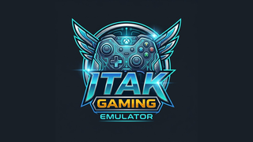

<!--
INSTRUCTIONS FOR THIS FILE (user and AI: read before editing. Keep this header.)

WHAT THIS FILE IS: the project's front door on GitHub. A stranger decides
in ten seconds whether this project is real. Everything here must be true
today: badges only when true, status only with proof, quickstart commands
copied from the working build.

EXACT STRUCTURE: centered title in exact brand casing, one-line promise,
true badges, the standard-files link row, What it is, Quickstart, the
module map (the grid), Status, License. Full art direction lives in the
github-repo-standard skill (README standard + README-PATTERNS.md).

RULES:
- Brand casing is exact: AlphaVision, AlphaFlux, iTaK, Mimir,
  Patriot Pest Control in full.
- David's taste: black background with a bright color on top so things
  pop is his preferred look; black and red are his favorite scheme, not
  a law. Each project picks its own palette.
- No secrets, passwords, or tokens in this file, ever.
-->
<div align="center">

# iTaK Gaming

A family arcade for the living room: pick a system, pick a game, play on the TV.




</div>

**Plan:** [PLAN.md](PLAN.md) · **Tasks:** [TODO.md](TODO.md) · **Ideas:** [IDEA.md](IDEA.md) · **Build rules:** [docs/RULES.md](docs/RULES.md)

## What it is

iTaK Gaming is a family arcade emulator built by a disabled veteran for his family, and open source so other families can use it too. It has no accounts and no RetroArch dependency. The Flutter frontend is built for a TV remote first, and the Go backend runs emulator cores directly.

Players keep separate profiles and save states. The app checks for its own updates, and online play uses public lobbies while both sides run the same game locally.

## What works today

- Flutter TV frontend with system select, game grid, player profiles, online lobbies, leaderboard, settings, logs, avatars, and update offers
- Go emulator host with core-negotiated pixel formats, correct aspect handling, audio capture, controller input, and per-player save states
- Clean-room Go core modules under `cores/` for the bundled system families
- Public lobby netplay with open or password lobbies, spectators, friends, play stats, and leaderboards
- Lockstep online play: only inputs and signals cross the network, never a streamed game
- Self-update checks with SHA-256 verification before the installer opens
- Headless backend and core test harnesses

## Quickstart

Try the backend:

```bash
cd go_backend
go build ./...
go run ./cmd
curl http://127.0.0.1:8081/api/systems
```

Run the lobby server:

```bash
cd netplay
go run ./cmd/lobbyserver
go test ./...
```

Headless core tests need a core and a legally obtained game or test program supplied by the developer. See each core README under `cores/` for its proof status and limits.

## The grid: module map

| Module | What it owns |
| :--- | :--- |
| `flutter_ui/` | TV-first frontend: menus, game grid, profiles, online room, leaderboard, settings, logs, updates |
| `go_backend/` | Emulator host: core bridge, video, audio, input, saves, local API, mobile binding, test tools |
| `cores/go-*` | One clean-room Go core module per system, with tests beside each chip and subsystem |
| `netplay/` | Lobby server, WebSocket signaling, spectators, friends, stats, leaderboards, app distribution |
| `MISSOURI-KIT.md` | Family setup and recovery instructions for the Missouri box |
| `SPECTATOR_DESIGN.md` | Spectator and big-lobby design |
| `VOICE_CHAT_RESEARCH.md` | Voice chat research and the limits of TV microphones |

## Platform builds

| Build | Targets | Systems |
| :--- | :--- | :--- |
| Android 32-bit | Chromecast HD | The lighter system set that fits the stick |
| Android 64-bit | Google TV Streamer, Shield, stronger TV boxes | The wider system set |
| Windows 64-bit | PC | All supported systems |
| Linux 64-bit | PC and repurposed boxes | All supported systems |

Builds are separate on purpose. A weak TV stick does not carry systems it cannot run well.

## ROMs, firmware, and cores

This repo ships **no ROMs and no core binaries**. Both are excluded by `.gitignore`.

- Games: use your own legally obtained backups.
- Firmware or BIOS files: supply your own where a system needs one.
- Cores: the source tree carries the project's Go core modules; external libretro cores, where still used by a build, remain separate projects with their own licenses.

Saves live under `saves/<player>/<game>/slot<N>.sav`, with 10 slots per player per game. Switching players switches save sets.

## Status

iTaK Gaming 1.62, build 63, was published to the update feed and its public APK hash was verified on 2026-10-17. The detailed proof and remaining work live in [TODO.md](TODO.md). A build is not called ready here until the shipped app has been run on the target device and a game has launched.

## License

MIT for the code in this repository; see [LICENSE](LICENSE). External cores and libraries keep their own licenses. Respect the license manifest for the exact build before adding any revenue feature.
