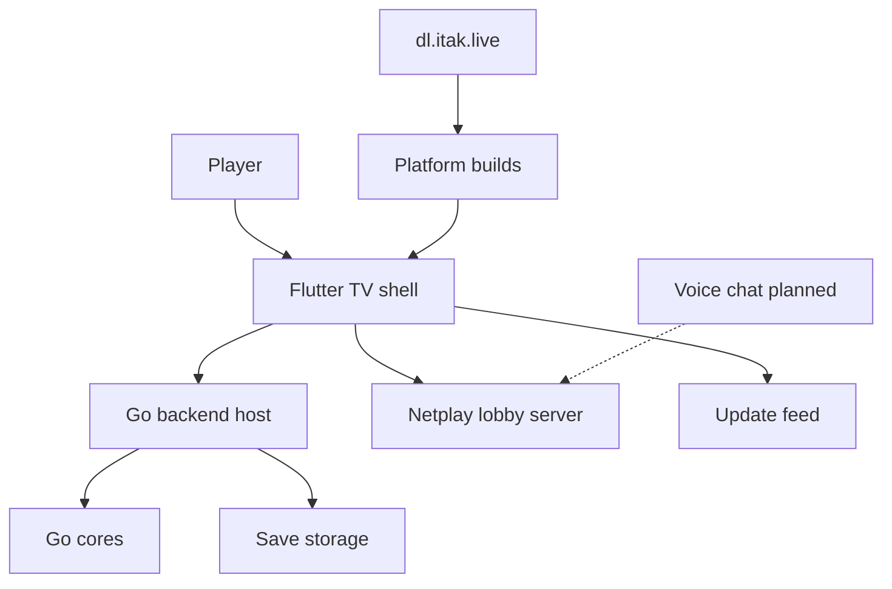

<!--
INSTRUCTIONS FOR THIS FILE (user and AI: read before editing. Keep this header.)

WHAT THIS FILE IS: the whole project laid out, at docs/MAP.md: every
module, page, screen, engine, and service, and every link between them
traced BOTH ways (what it points to, and what points back at it). It
exists so anyone can see the entire system at once and think about it
whole. A rendered visual version is generated from this file.

EXACT STRUCTURE:
- "## The grid": a table of every node: name, kind (page, screen,
  module, engine, service, external), what it owns.
- "## Links": a table of every connection: from, to, kind (navigates,
  calls, reads, writes, emits, hosts), and the backlink (the reverse
  relationship, named, or "none").
- "## Diagram": a Mermaid flowchart of the same nodes and links, kept
  in sync with the tables above it.
- "## Flows": the two or three main journeys through the system, in
  words, step by step.

RULES:
- Every node in the tables appears in the diagram and vice versa.
- When a module or link is added or removed, this file changes in the
  same commit.
- Facts only: the map shows what exists, with planned nodes marked
  (planned) so vision and reality never blur.
- No secrets, passwords, or tokens in this file, ever.
-->
# MAP: iTaK Gaming

## The grid
| Node | Kind | Owns |
| :--- | :--- | :--- |
| Player | external | Family players on TV sticks, phones, and PCs |
| Flutter TV shell (flutter_ui) | screen | System select, game grid, profiles, online play, leaderboard, settings, logs, self-update |
| Go backend host (go_backend) | engine | Core bridge, video, audio, input, per-player save states, local API, mobile binding |
| Go cores (cores/go-*) | engine | Clean-room emulator cores: NES, SNES, Game Boy/Color, GBA, Genesis/Sega CD, PS1, N64, DS, PSP, Dreamcast, Saturn, GameCube |
| Save storage | module | saves/<player>/<game>/slot<N>.sav, 10 slots per player per game |
| Netplay lobby server (netplay/) | service | Public lobbies, host/guest tokens, signaling relay, spectators, friends, stats, leaderboard, update feed hosting |
| Update feed | service | Version metadata plus APK with SHA-256; the app checks, verifies, downloads, installs |
| Platform builds | module | Android 32-bit, Android 64-bit, Windows 64-bit, Linux 64-bit builds from one source revision |
| dl.itak.live (David's Downloads) | external | Download page and device-setup categories for family installs |
| Voice chat | module (planned) | USB-microphone-first voice for netplay; research only until David decides (TODO T-4.9) |

## Links
| From | To | Kind | Backlink |
| :--- | :--- | :--- | :--- |
| Player | Flutter TV shell | navigates | Shell renders menus, grids, and dialogs back |
| Flutter TV shell | Go backend host | calls | Backend returns frames, audio, and state to the shell |
| Go backend host | Go cores | calls | Cores return video, audio, and save data to the host |
| Go backend host | Save storage | writes | Save storage returns the selected player's slots to the host |
| Flutter TV shell | Netplay lobby server | calls | Lobby returns rosters, signals, stats, and leaderboard to the shell |
| Netplay lobby server | Netplay lobby server (peer client) | emits | Inputs and signals relay both ways; game state never crosses |
| Flutter TV shell | Update feed | reads | Feed returns version metadata and the APK |
| Platform builds | Flutter TV shell | hosts | The shell is what each platform build ships |
| dl.itak.live | Platform builds | hosts | Builds are fetched from the download page for manual installs |
| Voice chat (planned) | Netplay lobby server | calls | Lobby would carry voice alongside signaling |

## Diagram

## Flows
1. Local play: the player picks a system and game in the TV shell; the backend host loads the matching Go core, negotiates its video format, and runs it with the player's controller input; saves land in that player's own slots.
2. Online play: both players open the same lobby, run the same core and ROM locally, and exchange lockstep inputs through the lobby relay, Kentucky to Missouri; spectators watch through host snapshots and chat. The server never holds or serves the game.
3. Update: the shell checks the feed, compares versions, verifies the APK SHA-256, downloads, and hands off to the installer; a failed download leaves the running build untouched.
