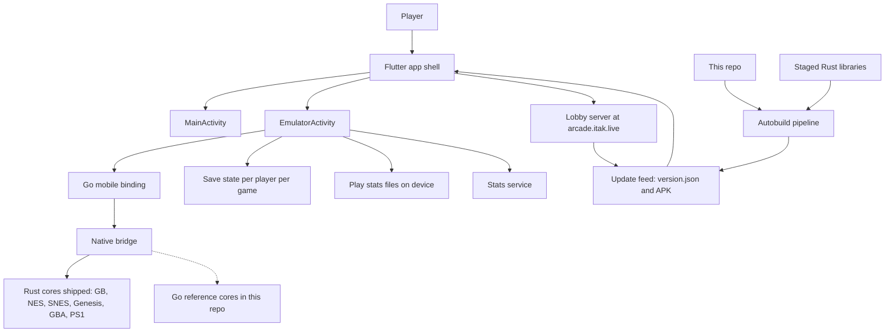
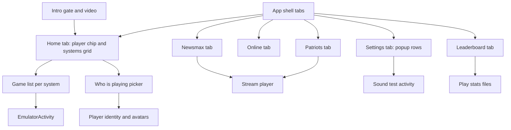
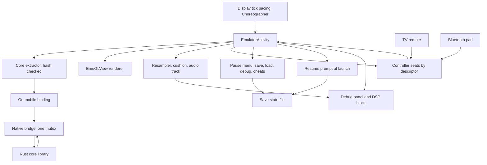
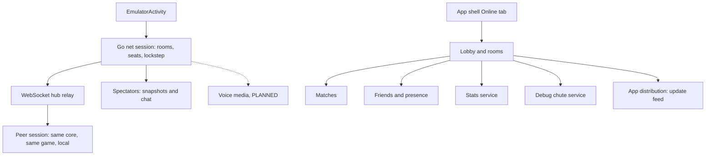
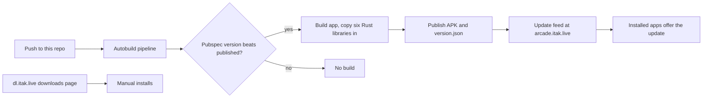

# Diagram sheets: iTaK Gaming

Mermaid diagrams of the same nodes and wires listed in INVENTORY.md
and WIRES.md. One sheet per family. Planned items are drawn with
dotted lines.

## Sheet 1: Overview

## Sheet 2: App shell

## Sheet 3: One local game session

## Sheet 4: Netplay and services

## Sheet 5: Build and publish

